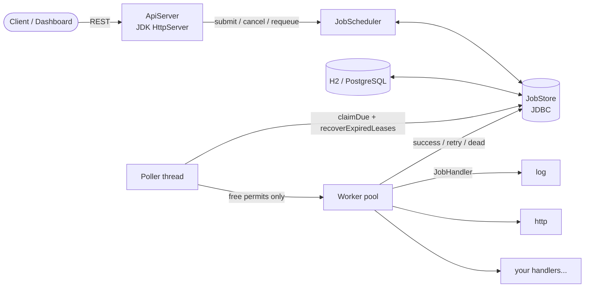
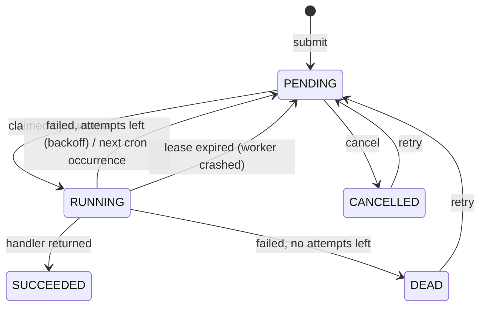

# job-scheduler

[](https://github.com/praneetkamble/job-scheduler/actions/workflows/ci.yml)

[](LICENSE)

A small, dependency-light **persistent job queue and scheduler** for Java 21. Enqueue immediate, delayed or
cron-recurring jobs over a REST API; a pool of workers executes them with **exponential-backoff retries**, and every
state change is stored in a database (H2 or PostgreSQL), so jobs survive restarts and several instances can share
one queue. A tiny dashboard is served at `/`.

There is no framework: the HTTP layer is the JDK's built-in `HttpServer`, persistence is plain JDBC with HikariCP, and the
cron parser is hand-written (and tested).

## Features

- **Immediate, delayed and recurring jobs**: `delaySeconds`, absolute `runAt`, or a five-field `cron` expression.
- **Retries with exponential backoff** and jitter (`base * 2^(attempt-1)`, capped). After `maxAttempts` a job is
  `DEAD` and can be re-queued from the API/dashboard.
- **Worker thread pool** with back-pressure: a scheduler never claims more jobs than it has free workers.
- **Durable and multi-instance safe**: claims are atomic compare-and-set updates; run several instances against one
  PostgreSQL and each job still runs once at a time.
- **Crash recovery**: claimed jobs carry a *lease*. If a worker dies, the lease expires and another instance
  re-queues (or buries) the job. A zombie worker can no longer overwrite the result.
- **Own cron parser**: `*`, lists, ranges, steps, month/weekday names, `@daily`-style macros, Vixie day-of-month/day-of-week
  semantics and leap-day handling.
- **REST API + dashboard** (live-refreshing, enqueue/cancel/retry from the browser).
- **Pluggable handlers**: register a `JobHandler` lambda per job type. Built-ins: `log`, `sleep`, `flaky`, `http` (webhook).
- Single **shaded jar**, Dockerfile and a two-instance Docker Compose stack.

## Architecture



### Job life cycle



Recurring jobs never end up `SUCCEEDED` or `DEAD`: after every run (successful or not) they go back to `PENDING`
with `runAt` set to the next cron occurrence, and `lastError` keeps the most recent failure.

## Getting started

Requirements: JDK 21 and Maven (or just Docker).

```bash
mvn verify                       # build + 66 tests
java -jar target/job-scheduler-1.0.0.jar
# -> http://localhost:8080  (dashboard)
```

With Docker Compose (PostgreSQL and two competing scheduler instances):

```bash
docker compose up --build
# instance 1: http://localhost:8080   instance 2: http://localhost:8081
```

### Configuration (environment variables)

| Variable | Default | Meaning |
|---|---|---|
| `PORT` | `8080` | HTTP port |
| `JDBC_URL` | `jdbc:h2:file:./data/scheduler;AUTO_SERVER=TRUE` | Any JDBC URL; `jdbc:postgresql://...` works out of the box |
| `DB_USER` / `DB_PASSWORD` | - | Database credentials |
| `WORKERS` | `4` | Worker threads (max concurrent jobs per instance) |
| `POLL_MS` | `500` | Polling interval |
| `BACKOFF_BASE_MS` / `BACKOFF_MAX_MS` | `2000` / `3600000` | Retry backoff base and cap |
| `WORKER_ID` | random | Identifier recorded in `lockedBy` |

## API

| Method | Path | Description |
|---|---|---|
| `POST` | `/api/jobs` | Enqueue a job (`201` + `Location`) |
| `GET` | `/api/jobs?status=&limit=` | List jobs, newest first |
| `GET` | `/api/jobs/{id}` | Job details |
| `DELETE` | `/api/jobs/{id}` | Cancel a `PENDING` job (`409` otherwise) |
| `POST` | `/api/jobs/{id}/retry` | Re-queue a `DEAD` or `CANCELLED` job |
| `GET` | `/api/stats` | Counts per status and worker metrics |
| `GET` | `/health` | Liveness |

```bash
# run now
curl -X POST localhost:8080/api/jobs -H 'Content-Type: application/json' \
  -d '{"type":"log","payload":{"message":"hello"}}'

# run in 10 minutes, at most 3 attempts
curl -X POST localhost:8080/api/jobs -H 'Content-Type: application/json' \
  -d '{"type":"http","payload":{"url":"https://example.com/hook","method":"POST","body":"{}"},"delaySeconds":600,"maxAttempts":3}'

# every weekday at 09:30 (UTC)
curl -X POST localhost:8080/api/jobs -H 'Content-Type: application/json' \
  -d '{"type":"log","payload":{"message":"stand-up"},"cron":"30 9 * * MON-FRI"}'

# watch the retry/backoff machinery: fails twice, succeeds on attempt 3
curl -X POST localhost:8080/api/jobs -H 'Content-Type: application/json' \
  -d '{"type":"flaky","payload":{"failTimes":2}}'
```

Example response:

```json
{
  "id": "e2c5cc6e-fcab-409d-b004-2c0210df43c0",
  "type": "flaky",
  "payload": {"failTimes": 2},
  "status": "PENDING",
  "runAt": "2026-11-02T14:31:53.290Z",
  "attempts": 0,
  "maxAttempts": 5,
  "cron": null,
  "runCount": 0,
  "lastError": null,
  "lockedBy": null
}
```

Cron expressions are evaluated in UTC. Errors are returned as `{"error": "..."}` with `400`, `404`, `405`, `409` or `413`.

## Writing your own handler

```java
HandlerRegistry registry = HandlerRegistry.withBuiltIns();
registry.register("send-email", ctx -> {
    String to = ctx.payload().get("to").asText();
    mailer.send(to, ...);               // throw to fail the attempt and trigger a retry
});

SchedulerConfig config = SchedulerConfig.defaults();
JobScheduler scheduler = new JobScheduler(new JdbcJobStore(dataSource), registry, config, Clock.systemUTC());
scheduler.start();
scheduler.submit(NewJob.of("send-email", "{\"to\":\"a@b.c\"}"));
```

Delivery is **at-least-once**: if a worker crashes mid-job it will be re-run, so handlers should be idempotent.

## Design decisions

- **Optimistic claiming instead of `SELECT ... FOR UPDATE SKIP LOCKED`.** A claim is `SELECT` the due ids, then
  `UPDATE ... WHERE id = ? AND status = 'PENDING'` per job; the row count tells whether we won. It is a bit chattier
  than `SKIP LOCKED`, but runs unchanged on H2 and PostgreSQL (and most other databases), needs no explicit transactions
  and is trivially correct, which a concurrent-claimers test verifies.
- **Leases instead of heartbeats.** Simple and robust: if the lease passes, the job is considered abandoned. Every
  completion is guarded by `locked_by = ?`, so a slow worker that lost its lease cannot clobber the new owner's result.
  Pick a lease longer than your longest job.
- **Timestamps as epoch milliseconds (`BIGINT`).** Avoids time-zone and type differences between databases; all
  comparisons are simple integers and the clock is injected (`java.time.Clock`), which makes the whole engine
  testable with a movable clock and no sleeping.
- **Back-pressure through permits.** The poller takes all free permits from a semaphore, claims at most that many jobs
  and returns unused permits, so the queue stays in the database (visible to other instances) rather than in memory.
- **Backoff with jitter** shortens (never extends) the delay by up to 20 % so a burst of failures does not retry in lock-step.
- **No framework.** Everything fits in ~1.5k lines and starts in under a second; the JDK `HttpServer` runs request handlers on
  virtual threads.
- **Hand-written cron** keeps the project dependency-free and lets the tests pin down edge cases (DOM/DOW OR semantics, leap days,
  impossible dates fail instead of looping forever).

## Tests

`mvn verify` runs 66 JUnit 5 tests: cron parsing and next-fire computation, backoff maths, the JDBC store (including
concurrent claimers, lease recovery and zombie writers), the scheduler engine (deterministic, using a mutable clock:
retries, dead letters, recurring jobs, capacity limits, crash recovery) and the HTTP API end-to-end. The suite
also passes against a real PostgreSQL instance.

## Tech stack

Java 21 · JDBC + HikariCP · H2 / PostgreSQL · Jackson · JDK `HttpServer` · SLF4J · JUnit 5, AssertJ, Awaitility ·
Maven (shaded jar) · GitHub Actions · Docker

## License

[MIT](LICENSE)
